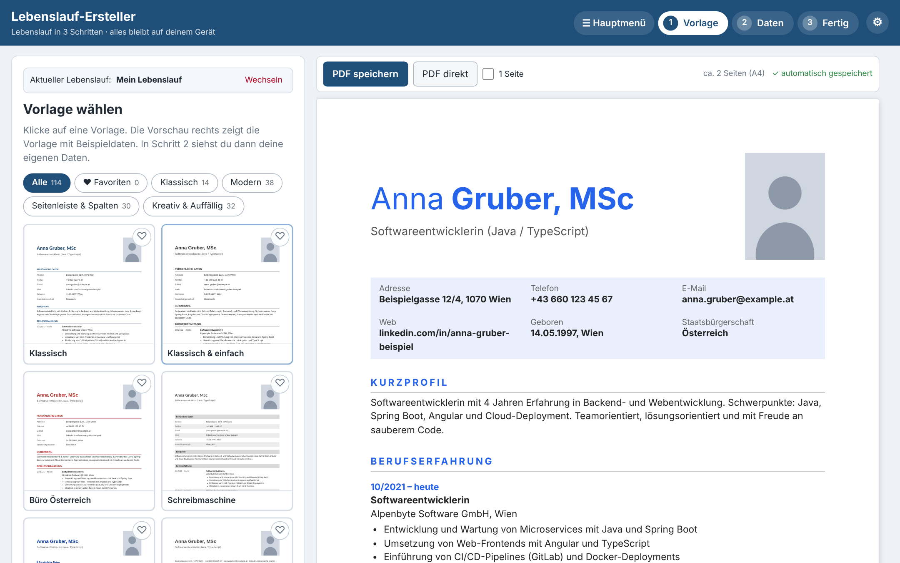
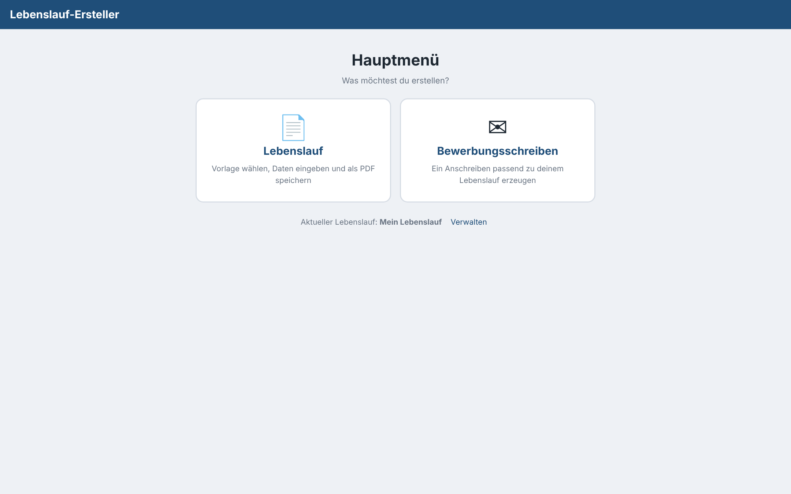
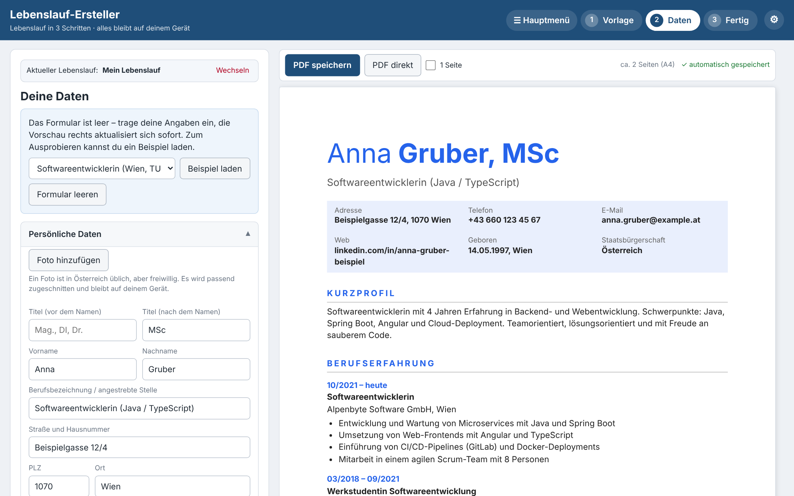
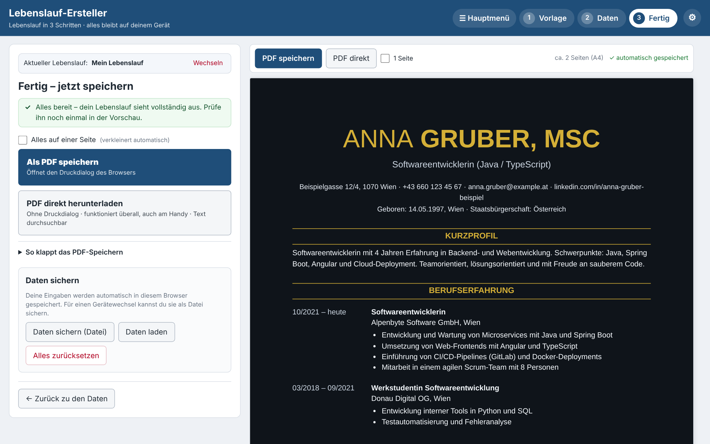
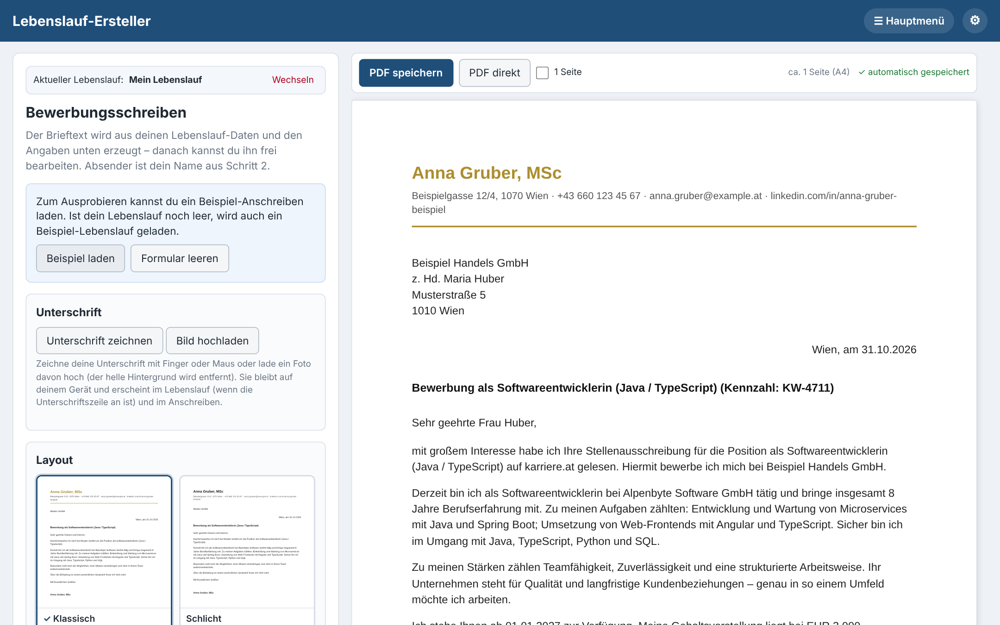
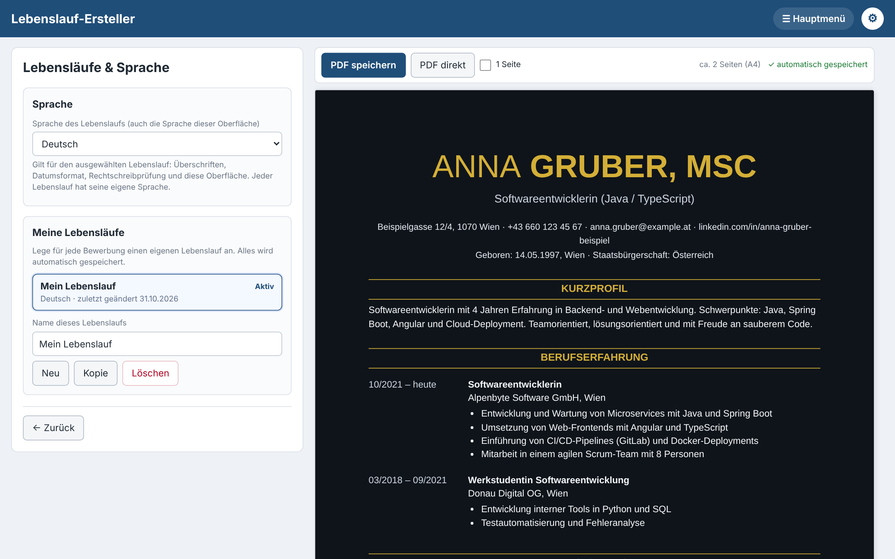

<div align="center">


# Lebenslauf-Ersteller

**CV and cover letter maker in a single HTML file.**

Pick one of 114 templates, fill in your details and download a clean PDF —<br>
plus a matching cover letter. Everything stays on your own device.

[**▶ Try it live**](https://brickey8171.github.io/Lebenslauf/) &nbsp;·&nbsp;
[Features](#-features) &nbsp;·&nbsp;
[Getting started](#-getting-started) &nbsp;·&nbsp;
[Privacy](#-privacy)


[](https://github.com/Brickey8171/Lebenslauf/stargazers)

<br>



</div>

---

## ✨ Why Lebenslauf-Ersteller?

- **One file, zero setup.** Double-click `index.html` or host it on GitHub Pages. No build step, no server, no sign-up.
- **114 templates.** Classic, modern, sidebar and creative designs, with free choice of colours, fonts and spacing.
- **CV *and* cover letter.** A main menu lets you switch between the two; each CV keeps its own letter.
- **Three languages.** German, English and Hungarian — the language of your CV also switches the whole interface.
- **Private by default.** Your data is stored in your browser and never uploaded anywhere.

## 📸 Screenshots

<table>
  <tr>
    <td width="50%"><br><sub><b>Main menu</b> — switch between CV and cover letter</sub></td>
    <td width="50%"><br><sub><b>Editor</b> — fill in your data, the preview updates as you type</sub></td>
  </tr>
  <tr>
    <td width="50%"><br><sub><b>Dark layouts</b> — and the PDF export screen</sub></td>
    <td width="50%"><br><sub><b>Cover letter</b> — generated from your CV, 9 layouts, signature</sub></td>
  </tr>
  <tr>
    <td colspan="2" align="center"><br><sub><b>CVs &amp; language</b> — manage several CVs, change the language (gear, top right)</sub></td>
  </tr>
</table>

## 🧰 Features

<details open>
<summary><b>📋 CV (Lebenslauf)</b></summary>

- **114 templates** in four groups: Classic (14), Modern (38), Sidebars & columns (30), Creative & eye-catching (32)
- Favourites, similar-template sorting and your own saved templates
- Colours, fonts, spacing, column layout and header style adjustable
- Guided flow in three steps: **Template → Data → Done**
- Photo upload with **cropping** and a built-in editor (optional)
- Sample CVs to try every feature, in all three languages
- Several CVs side by side — create, copy, rename or delete them
- "Everything on one page" option that shrinks the content to fit

</details>

<details>
<summary><b>✉️ Cover letter (Bewerbungsschreiben)</b></summary>

- Letter text is **generated from your CV data** plus job, company, contact person and your strengths
- Choose a **formal** or a **modern & personal** tone — every paragraph changes
- **9 layouts** with colours and fonts
- Correct salutation (e.g. *Sehr geehrte Frau Huber*), in German, English and Hungarian
- Text stays **fully editable**; regenerate it whenever you like
- Sample letter to try it out

</details>

<details>
<summary><b>✍️ Signature</b></summary>

- **Draw** it with finger or mouse, or **upload a photo** of your signature
- Background is removed automatically
- Stays readable on **dark layouts** (automatic light variant)
- Works for the CV and the cover letter

</details>

<details>
<summary><b>🌍 Languages</b></summary>

- **German, English and Hungarian**
- The CV language switches the interface, section titles, date formats and letter phrases together

</details>

<details>
<summary><b>📥 Export & data</b></summary>

- **PDF direct** — a PDF file with selectable, searchable text, no print dialog (also works on phones)
- **PDF via print dialog** for the browser's own PDF output
- **Backup file** of all CVs and letters, and import
- Automatic saving in your browser

</details>

## 🚀 Getting started

### Use it online

Open **[brickey8171.github.io/Lebenslauf](https://brickey8171.github.io/Lebenslauf/)** — nothing to install.

### Use it locally

1. Download **[`index.html`](https://github.com/Brickey8171/Lebenslauf/raw/main/index.html)** (or clone the repo: `git clone https://github.com/Brickey8171/Lebenslauf.git`).
2. Open it in a modern browser (Chrome, Edge, Firefox or Safari).
3. Choose **Lebenslauf** or **Bewerbungsschreiben** and start.

### Host it on GitHub Pages

1. [Fork this repository](https://github.com/Brickey8171/Lebenslauf/fork) (or create your own and add `index.html`).
2. Go to **Settings → Pages**, choose your branch and folder, and click **Save**.
3. Your app is live at `https://<your-username>.github.io/<repository>/`.

No configuration is needed — it's a static page.

## 🧭 How it works

```
 Main menu
 ├── 📋 Lebenslauf            ① Template  →  ② Data  →  ③ Done (PDF)
 ├── ✉️ Bewerbungsschreiben   Job · company · tone · layout · signature → PDF
 └── ⚙️ (gear, top right)     Manage CVs · language · backup
```

> 💡 Use **Beispiel laden** (load sample) to fill the form with example data and explore everything first.

## 🔒 Privacy

- Your CVs, letters, photos and signatures are saved **only in your browser** (`localStorage`).
- **Nothing is uploaded**, and there are no analytics, cookies or trackers.
- PDFs are generated on your device.

> 💡 Because storage is per browser, use **Daten sichern** now and then to download a backup file, or to move your data to another device. Clearing your browser data deletes your saved CVs.

## 🛠 How it's built

Plain HTML, CSS and JavaScript in one file, with no framework, no libraries and no build step.

- **Layout engine** — each template is a set of settings (colours, columns, header, spacing) that renders the CV as HTML
- **PDF** — the page is rendered into images with an invisible text layer on top, so text stays selectable and searchable
- **Translations** — German, English and Hungarian interface texts, applied live
- **Storage** — `localStorage`, with a backup file for moving data

## ⚠️ Known limitations

- The cover letter is a **template-based generator, not AI**. Your own entries are inserted as written, so check grammar and endings before sending.
- Template names stay in German in every interface language.
- Signature photos with ruled paper lines can leave a faint line — drawing it gives the cleanest result.
- Tested mainly in Chromium; Safari behaviour may differ in details.

## 🗺 Ideas

- [ ] Match the cover letter automatically to the CV template
- [ ] Job-ad keyword helper
- [ ] Download CV and letter as one bundle
- [ ] Running header on page 2 of long letters
- [ ] Installable app (PWA)

## 📄 License

Released under the [MIT License](LICENSE) — free to use, modify and share.

<div align="center"><br><sub>Made with ☕ by <a href="https://github.com/Brickey8171">Brickey8171</a> in Austria — <b>Lebenslauf-Ersteller</b>: your CV, ready in minutes.</sub><br><sub>Found a bug or have an idea? <a href="https://github.com/Brickey8171/Lebenslauf/issues">Open an issue</a>.</sub></div>
